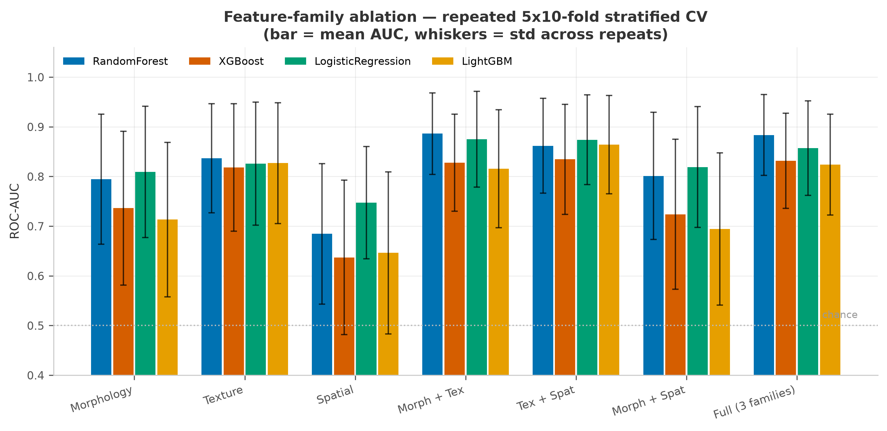
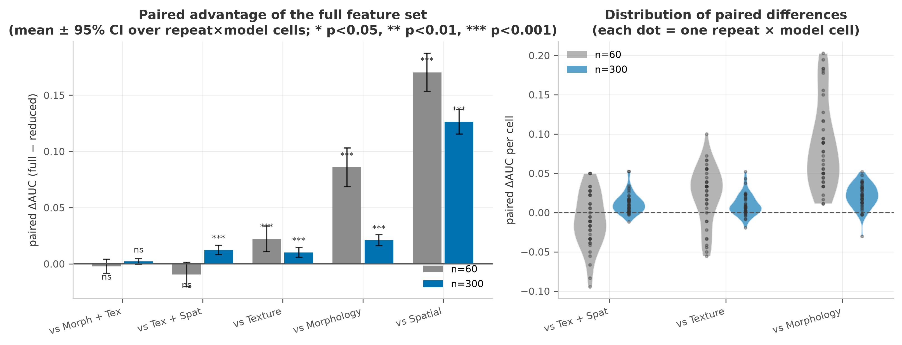
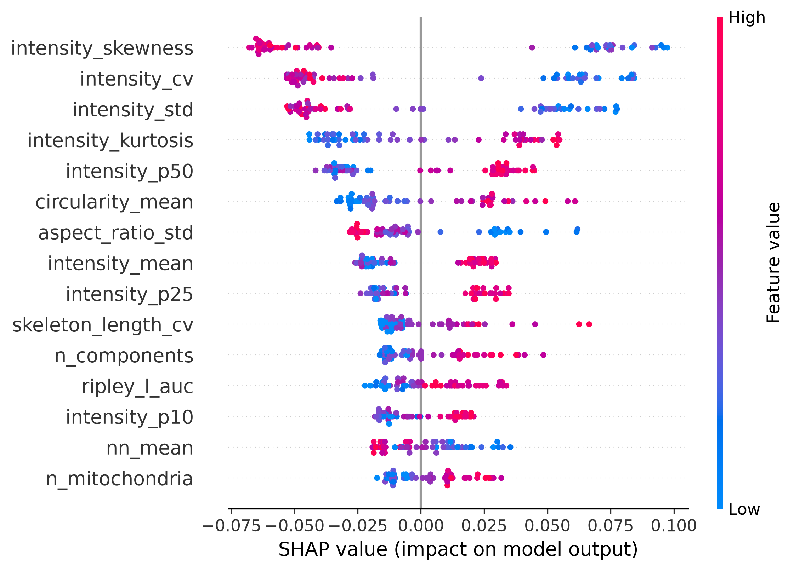
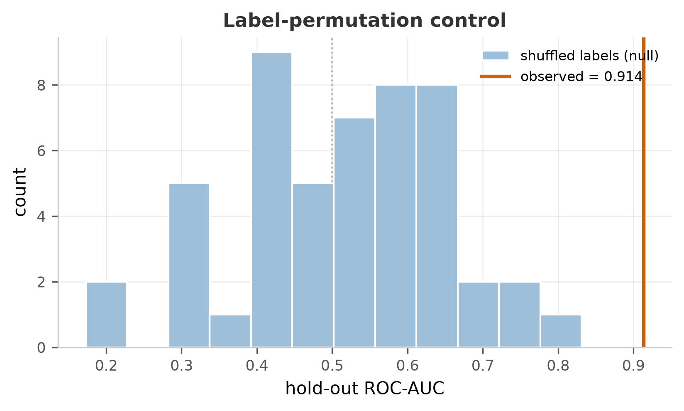
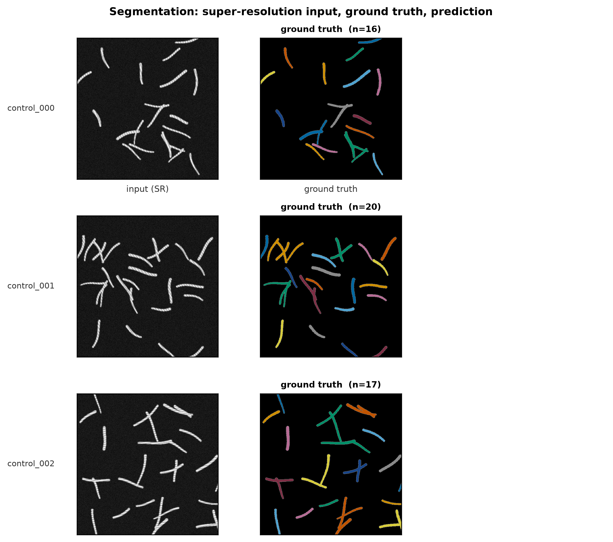

# MitoSAM 🔬

**Promptable segmentation & quantification of mitochondria in super-resolution microscopy.**

MitoSAM turns the Segment Anything Model into a mitochondria specialist — and then turns  
segmentation *masks* into biology *numbers*: morphology, texture and spatial-distribution  
features, an honest random-forest comparison with ablation and SHAP, a one-command  
reproduction pipeline, and a browser demo.

> Built as the engineering artefact behind a thesis on mitochondrial morphological  
> quantification in super-resolution images. The thesis asked *"does mitochondrial state  
> leave a measurable signature?"* — this repo answers it reproducibly.

---

## Why

Super-resolution microscopy (SIM/STED) produces images where classical thresholding breaks  
down — 16-bit dynamic range, uneven background, organelles at the resolution limit. On our  
held-out data, **Otsu thresholding reaches Dice 0.42** while a promptable foundation model  
reaches **Dice >0.9** with a single click. MitoSAM packages that idea into a tool:

|                | classical pipeline | MitoSAM                                     |
| -------------- | ------------------ | ------------------------------------------- |
| segmentation   | fixed threshold    | promptable SAM + CBAM adapter               |
| quantification | manual in FIJI     | 130 features / FOV, one command             |
| statistics     | ad-hoc             | ablation + label-permutation control + SHAP |
| interface      | none               | CLI + Gradio web demo                       |

## Architecture

```
                 ┌───────────────────────────── frozen (2.5 GB, ViT-H) ─────┐
image ──────────►│ SAM image encoder                                        │
                 └─────────────────────────────┬───────────────────────────┘
                                               │ (B,256,H/16,W/16)
                                      ┌────────▼─────────┐
                                      │ ResNet-CBAM      │  trainable (~3% params)
                                      │ embedding adapter│  restores thin cristae
                                      └────────┬─────────┘
 point/box prompt ─► SAM prompt encoder (frozen) ─► mask decoder (trainable) ─► mask
```

- **Why an adapter?** SAM's ViT embedding downsamples 16×; thin, low-contrast cristae —  
  the very signal biologists care about — get diluted. A gated ResNet-CBAM block re-weights  
  the embedding and starts as identity (gate init 0), so fine-tuning can only help.
- **Why frozen encoder?** Fine-tuning fits in 8 GB VRAM, checkpoints are a few MB  
  (not 2.5 GB), and the model keeps SAM's promptability for interactive correction.

Downstream, each field of view yields **~130 features** in three families:

| family          | examples                                                               | biological meaning        |
| --------------- | ---------------------------------------------------------------------- | ------------------------- |
| morphology (28) | area, aspect ratio, circularity, skeleton branches, network complexity | fission / fusion balance  |
| texture (46)    | intensity stats, GLCM, LBP                                             | cristae order and density |
| spatial (23)    | nearest-neighbour, Voronoi, Ripley's K/L, densities                    | distribution & clustering |

## Results (synthetic benchmark, see honesty notes below)

Primary metric: **repeated stratified CV** (5-fold x 10 repeats = 50 folds, mean over
4 models). A single hold-out split is noisy at n≈60 — one mis-ranked sample moves AUC
by ~0.11 — so it is reported only as a secondary check.

| feature subset    | repeated-CV AUC (mean ± std) | single hold-out AUC |
| ----------------- | ---------------------------- | ------------------- |
| texture only      | 0.827 ± 0.121                | 0.756               |
| morphology only   | 0.763 ± 0.143                | 0.855               |
| full (3 families) | **0.849 ± 0.093**            | **0.877**           |
| spatial only      | 0.679 ± 0.143                | 0.694               |

The benchmark is a **latent-severity generator**: each field of view draws one latent
state, and morphology / texture / spatial cues each depend on an *independently noisy*
copy of it. No single family solves the task — the full set beats texture-only
(+0.022, 3/4 models), morphology-only (+0.086, 4/4) and spatial-only (+0.170, 4/4).
Two-family combinations tie the full set at n=60; a scaling check at n=300 confirms
this is finite-sample variance, not redundancy — there the full set is on top with
p ≤ 1e-5 over texture+spatial and texture-only (see
[`results/figures/scaling_check.png`](results/figures/scaling_check.png) and the
technical report, §4.2).
An earlier generator version let texture alone reach AUC 0.99, which made every
ablation table trivially flat — a good reminder that a benchmark must be *hard enough*
to measure fusion gains.

Label-permutation control (50 permutations): observed AUC 0.914 vs shuffled-label null  
0.515 ± 0.140 (max 0.831), p = 0.02 → the signal is real, not leakage. Full numbers in  
[`results/tables/`](results/tables/) and the  
[technical report](docs/TECHNICAL_REPORT.md).

**⚠️ Honesty note:** the numbers above are on a *synthetic* cohort shipped in this repo  
(`mitosam demo-data`) so anyone can reproduce them. The labelled real dataset (40 FOVs of  
16-bit SR microscopy) cannot be published; on it, the thesis measured family-level AUCs of  
0.62 (spatial) to 0.99 (morphology+texture) with the same code paths.

## Figures

**Feature-family ablation** — repeated 5×10-fold stratified CV (mean ± std over 50 folds,
4 models). Full feature set beats every single family; two-family combinations tie it
at n=60 (see the scaling check below).



**Why the tie is noise, not redundancy** — paired ΔAUC (full − reduced) at n=60 vs
n=300. Grey distributions straddle zero (not significant); blue ones sit clearly above
it (p ≤ 1e-5 for texture+spatial and texture-only). A bar below zero marked *ns* means
"no detectable difference", not "three families are worse".



**SHAP attribution** — top drivers and per-family contribution (texture ≈ 64%,
morphology ≈ 28%, spatial ≈ 8% on the synthetic benchmark, matching the ablation
ordering).



**Label-permutation control** — the observed AUC sits far outside the shuffled-label
null (50 permutations, p = 0.02), so the signal is not leakage.



**Qualitative segmentation** — GT instances vs. prediction overlays on held-out fields.



All figures are regenerated from CSVs by `python -m MitoSAM.pipelines.run_all` —
no hand-drawn numbers anywhere.

## Install

```bash
git clone https://github.com/wanzi-qz/wanzi-mitosam.git
cd wanzi-mitosam
pip install -e ".[train,explain,gui]"        # or: pip install -r requirements.txt
pip install git+https://github.com/facebookresearch/segment-anything.git
```

SAM pretrained weights (only needed for training / zero-shot inference):

```bash
mkdir -p weights && cd weights
wget https://dl.fbaipublicfiles.com/segment_anything/sam_vit_b_01ec64.pth   # 375 MB
# vit_h: https://dl.fbaipublicfiles.com/segment_anything/sam_vit_h_4b8939.pth
```

## Quickstart (60 seconds, no GPU, no downloads)

```bash
# 1. synthetic demo cohort with known ground truth
python -m MitoSAM.cli demo-data --out examples/synthetic

# 2. full pipeline: features -> ablation -> permutation control -> SHAP -> figures
python -m MitoSAM.pipelines.run_all \
    --image-dir examples/synthetic/images --mask-dir examples/synthetic/masks \
    --groups examples/synthetic/labels.csv --out results

# 3. look at the figures
open results/figures/ablation_auc.png results/figures/shap_summary.png
```

## Usage

**Batch segmentation + quantification** (the tool a lab would actually run):

```bash
python scripts/batch_process.py --input_dir data/images --output_dir out \
    --method mitosam --checkpoint weights/mitosam_vit_b.pth \
    --features --previews --ground-truth-dir data/masks
# -> out/masks/*.png, out/batch_results.csv, out/features_per_image.csv
```

**Fine-tune on your own paired data:**

```bash
python scripts/train.py --image_dir data/train/images --mask_dir data/train/masks \
    --sam_type vit_b --epochs 3 --out weights
```

**Interactive segmentation (promptable API):**

```python
from MitoSAM.models import MitoSAM

model = MitoSAM("vit_b", checkpoint="weights/mitosam_vit_b.pth")
model.set_image("fov_017.png")                      # encoder runs once
masks, scores = model.predict(points=[[512, 300]], labels=[1])   # decoder per click
```

**Web demo:**

```bash
python -m MitoSAM.gui.app        # http://127.0.0.1:7860
```

Three tabs: *Segmentation* (upload → Otsu vs MitoSAM), *Quantification* (image+mask →  
per-organelle table + skeleton network), *Cohort analysis* (CSV → ablation + SHAP).

**Export to ONNX (deployment path):**

```bash
python -c "from MitoSAM.models.onnx_export import export_decoder_onnx; \
export_decoder_onnx('weights/mitosam_vit_b.pth','weights/decoder.onnx')"
```

The decoder graph (~20 MB) runs with onnxruntime — no PyTorch, no CUDA — so the  
interactive part of MitoSAM drops into a C++/Java service unchanged.

## Project layout

```
MitoSAM/
├── data/          dataset, patching, prompt strategies, synthetic cohort generator
├── models/        CBAM adapter, MitoSAM wrapper, training loop, ONNX export
├── features/      morphology / texture / spatial extraction -> tidy CSVs
├── evaluation/    segmentation metrics, ablation, permutation control, SHAP, figures
├── pipelines/     run_all.py — one command reproduces everything
├── gui/           Gradio demo (3 tabs)
├── scripts/       train.py, batch_process.py — the entry points a user touches
├── configs/       default.yaml — every hyperparameter in one place
├── results/       tables/, figures/, metrics/ (all reproducible)
├── docs/          TECHNICAL_REPORT.md — the paper, rewritten for engineers
└── demo.ipynb     guided walkthrough
```

## Design decisions an interviewer might ask about

- **Why keep SAM's API (`set_image`/`predict`) instead of a plain `forward`?**  
  The encoder is the expensive part (once per image); the decoder is per click. The  
  two-step API makes that asymmetry explicit and cacheable — see `MitoSAM/models/mitosam.py`.
- **Image-level splits everywhere.** Patches of the same field of view never straddle  
  train/test — the classic leak in microscopy ML. Enforced in `data/dataset.py::split_pairs`  
  and `evaluation/classification.py`.
- **Repeated-CV ablation with paired comparison** (`evaluation/classification.py`,
  `tables/ablation_paired.csv`), because with n=60 a single hold-out split is noise at the
  ±0.11 AUC level and can even make single feature families *look* better than the full set.
- **Label-permutation control as a first-class citizen** (`evaluation/permutation_test.py`):  
  train on shuffled labels; if your AUC sits inside that null, you measured noise.
- **Synthetic cohort with known ground truth** (`data/synthetic.py`): overlapping class  
  distributions, per-FOV exposure gain, per-organelle cristae variability — designed so the  
  ablation is *informative* rather than trivially separable, and so the whole repo runs  
  without the (unpublishable) real data.

## Limitations & roadmap

- [ ] SAM2 / video backbone for live-cell time series
- [ ] instance-level (not FOV-level) classifier with organelle tracking
- [ ] TensorRT encoder for real-time interactive use
- [ ] real-data release under a data-use agreement

## License

MIT (code). SAM weights follow Meta's own licence. The synthetic generator is original code.

## Acknowledgements

Built on [Segment Anything](https://github.com/facebookresearch/segment-anything)  
(Kirillov et al., 2023), [CBAM](https://arxiv.org/abs/1807.06521) (Woo et al., 2018),  
scikit-image and SHAP.
